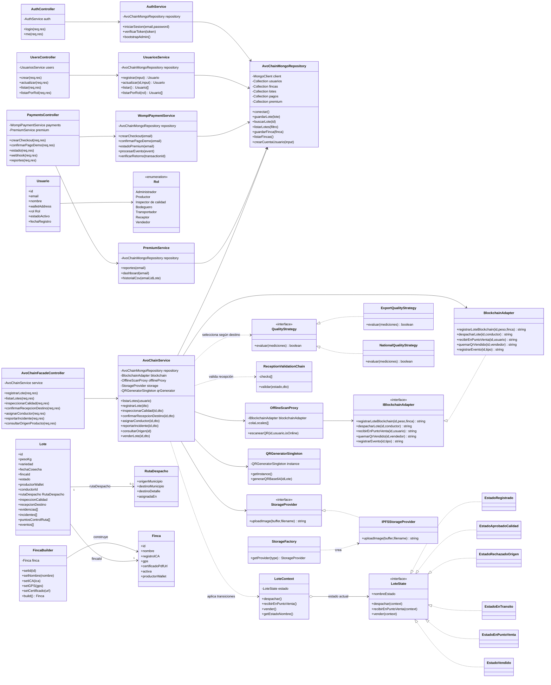
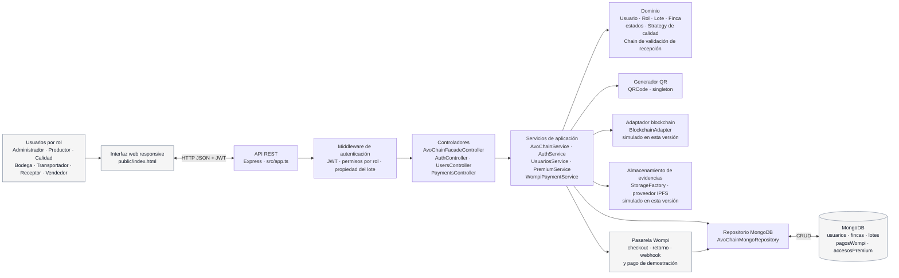

# Diagramas de clases y componentes de AvoChain

Los diagramas describen la implementación actual del proyecto. Puedes visualizarlos en un editor compatible con Mermaid, como Markdown Preview de VS Code o Mermaid Live.

## Diagrama de clases

## Diagrama de componentes

### Nota de implementación

La persistencia principal se realiza en MongoDB. En el estado actual del código, el adaptador de blockchain genera hashes simulados y el proveedor de almacenamiento devuelve enlaces de ejemplo tipo IPFS; no son todavía integraciones con una blockchain ni con un servicio IPFS/S3 real.
